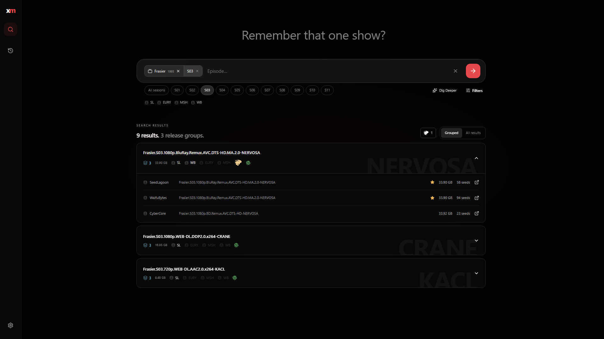
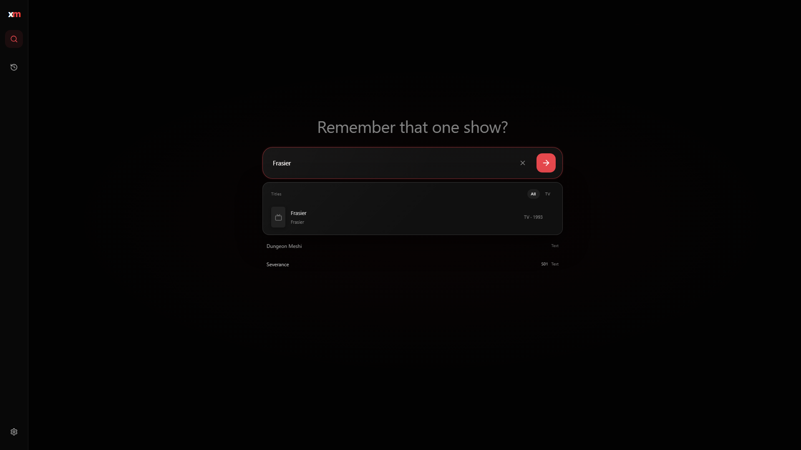
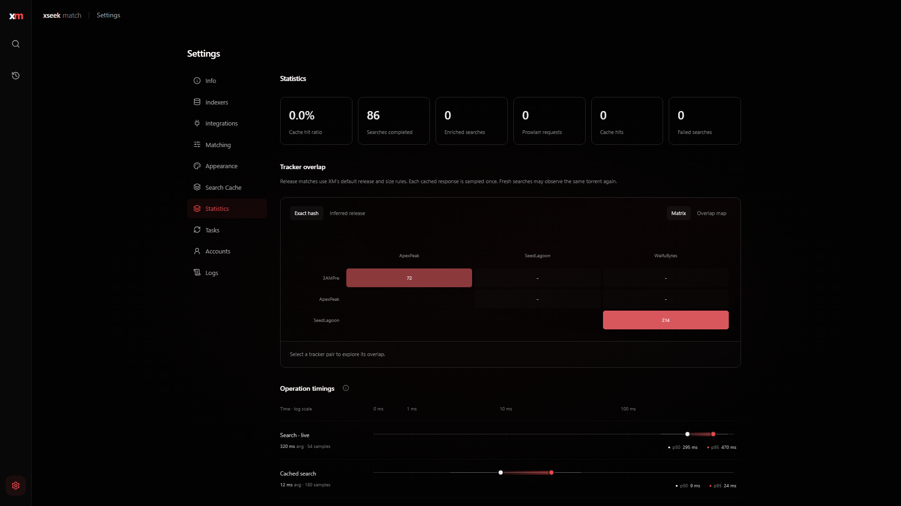
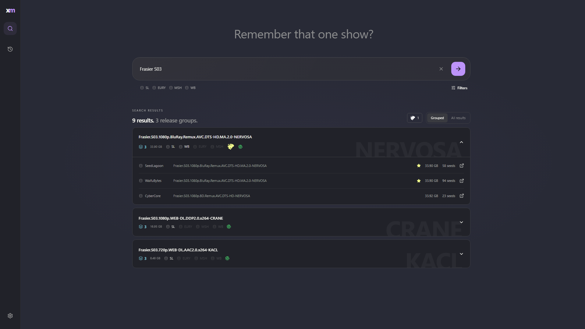
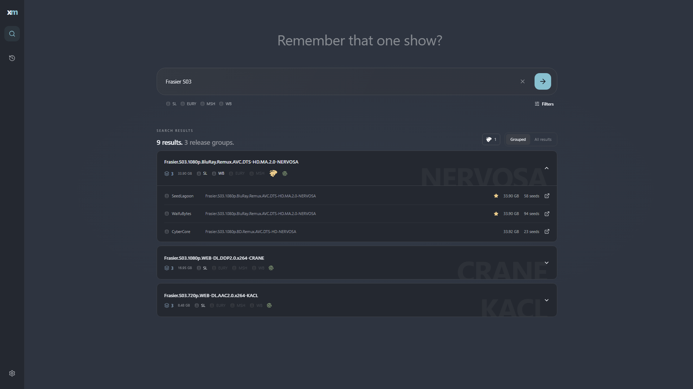
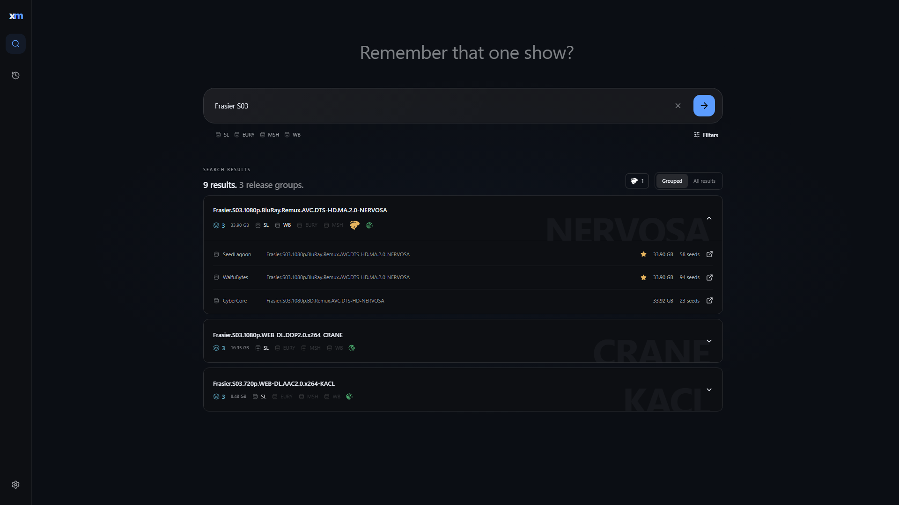
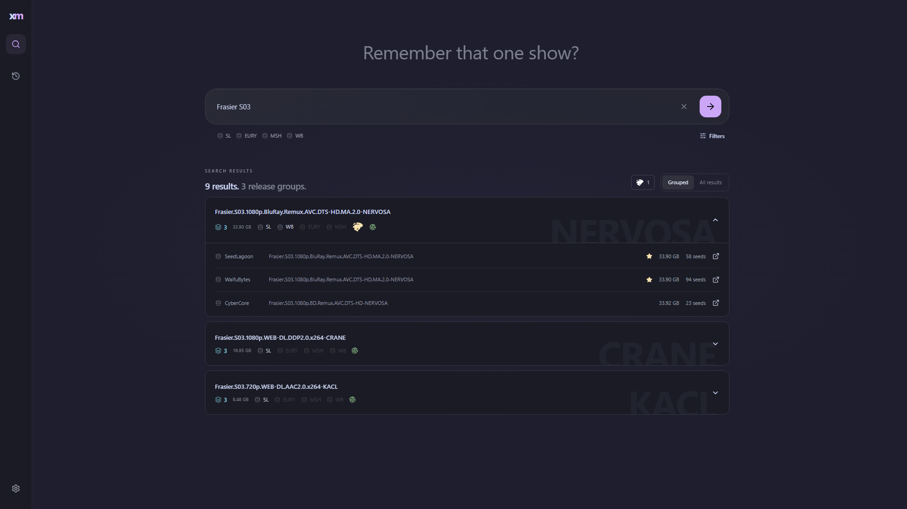

<picture>
  <source media="(prefers-color-scheme: dark)" srcset="docs/assets/xseek-match-lockup-dark.svg">
  <source media="(prefers-color-scheme: light)" srcset="docs/assets/xseek-match-lockup-light.svg">
  
</picture>

Find the same release across all your trackers, compatible with the Prowlarr you already run.

[](LICENSE)[](https://ghcr.io/getxseek/xseek-match)

---

xseek match searches your Prowlarr indexers all at once, groups matching releases together, with integrations for Sonarr, Radarr, and qui.

- **Release matching**: Instead of relying on exact release names, results are matched by their parsed metadata, even if a tracker renames an upload.
- **Preferred grabs**: Got a favourite tracker, one you're working towards or one with better bonuses, set it as a favourite.
- **Sonarr & Radarr integration**: Pulls title aliases and scene numbering directly from your *arr instances to broaden search coverage.
- **qui integration**: Connect your `qui` instance to highlight releases you already have in your client, never duplicate grab again!
- **Search history and stats**: Saves and heavily caches your searches to improve your search experience, with stats on content overlap across your trackers.



<details>
<summary><strong>More screenshots & themes</strong></summary>

### Integrations & statistics

| Title enrichment (Sonarr / Radarr) | Tracker overlap heatmap |
| --- | --- |
|  |  |

### Built-in themes

Switch themes or customize your accent color under **Settings → Appearance**.

| Dracula | Nord |
| --- | --- |
|  |  |

| Midnight | Catppuccin |
| --- | --- |
|  |  |

</details>

## Quick start

You need Docker and a running Prowlarr. xseek match listens on your network by default, so you can run it on a home server or NAS and open it from any device.

```bash
mkdir xseek-match && cd xseek-match
curl -fsSLO https://raw.githubusercontent.com/getxseek/xseek-match/main/compose.yaml
curl -fsSL -o .env https://raw.githubusercontent.com/getxseek/xseek-match/main/.env.example
```

Edit `.env`:

```dotenv
PROWLARR_BASE_URL=http://192.168.1.10:9696
PROWLARR_API_KEY=your-prowlarr-api-key
APP_ORIGIN=http://192.168.1.50:5178
```

Then start it:

```bash
docker compose up -d
```

Open your `APP_ORIGIN` address and create the owner account. **Do this right away:** until an owner exists, anyone on your network can claim it. After that, follow the onboarding to start searching.

<details>
<summary><strong>Getting the addresses right</strong></summary>

- `PROWLARR_BASE_URL` is seen from inside the container, so `localhost` won't work. Use `http://host.docker.internal:9696` if Prowlarr runs on the same machine, its LAN address if it doesn't, or its service name if both share a Docker network. Include Prowlarr's URL base if you set one.
- `APP_ORIGIN` is exactly what you type into the browser: scheme, host and port, no trailing slash. Sign-ins from any other address are refused with "Request origin is not allowed". If you see that, fix `APP_ORIGIN` and restart.
- **Plain HTTP is fine on private networks** (`192.168.x`, `10.x`, Tailscale, `.lan`, `.local`, single-word hostnames and similar). A public domain needs HTTPS through a reverse proxy.
- **Keep it on one machine** by changing the port mapping in `compose.yaml` to `127.0.0.1:5178:5178`.

</details>

<details>
<summary><strong>Running baremetal (without Docker)</strong></summary>

### Prerequisites

- **Node.js 24** or newer (`node -v`)
- Git

### Installation & build

```bash
git clone https://github.com/getxseek/xseek-match.git
cd xseek-match
cp .env.example .env
```

Edit `.env`. You can connect directly to `localhost` if Prowlarr runs on the same box:

```dotenv
PROWLARR_BASE_URL=http://127.0.0.1:9696
PROWLARR_API_KEY=your-prowlarr-api-key
APP_ORIGIN=http://127.0.0.1:5178
# PORT=5178
# HOST=0.0.0.0
# DATA_DIR=.local
```

Install dependencies and build the client and server:

```bash
npm ci
npm run build
```

Run the server:

```bash
npm start
```

Your data and caches are stored locally in the directory set by `DATA_DIR` (defaults to `./.local`).

</details>

## Configuration

All settings are environment variables, read at startup. Restart after changing them.

| Variable | Default | What it does |
| --- | --- | --- |
| `PROWLARR_BASE_URL` | none | Prowlarr address, as seen by the server |
| `PROWLARR_API_KEY` | none | Prowlarr API key (Settings → General in Prowlarr) |
| `PROWLARR_API_KEY_FILE` | none | Read the key from a file instead, e.g. a Docker secret |
| `APP_ORIGIN` | `http://localhost:5178` | The address you open in the browser |
| `PORT` | `5178` | Port to listen on |
| `HOST` | `0.0.0.0` | Listen address; `127.0.0.1` keeps it local |
| `DATA_DIR` | `/data` in Docker, `.local` natively | Database and caches |

Everything else (integrations, important trackers, matching rules, cache lifetime, accent color) lives in the app under **Settings**.

## Integrations

Add Sonarr, Radarr and qui under **Settings → Integrations**. You can add several of each.

| Service | What xseek match uses it for |
| --- | --- |
| Sonarr / Radarr | Title suggestions, posters and aliases for *Enrich* |
| qui | Marking results you already have in your torrent client |

These are read-only calls. API keys stay on the server and are never sent back to the browser. They're stored unencrypted in the database, so treat the data volume and its backups like credentials.

## Accounts and passwords

There's a single owner account. Change your password or sign out under **Settings → Accounts**.

Forgot it? Reset it directly from the console:

```bash
docker compose exec xseek-match node build/server/reset-password.js
```

The command prompts for the new password twice and revokes all active sessions. There is no email or browser-based recovery.

Failed sign-ins are rate-limited: 10 failures from one address, or 60 in total within 15 minutes, locks sign-in until the window passes.

## Updating and backups

### Updating

* **Docker:**
  ```bash
  docker compose pull && docker compose up -d
  ```
* **Baremetal:**
  ```bash
  git pull
  npm ci
  npm run build
  # restart your service or process:
  sudo systemctl restart xseek-match
  ```

### Backups

All state lives in the data store: the SQLite database (accounts, settings, history) and disposable search caches. Stop the process before copying to ensure the database is consistent:

* **Docker:**
  ```bash
  docker compose stop
  docker compose cp xseek-match:/data ./match-backup
  docker compose start
  ```
* **Baremetal:**
  ```bash
  sudo systemctl stop xseek-match
  cp -r .local ./match-backup   # or your custom DATA_DIR
  sudo systemctl start xseek-match
  ```

Backups contain session secrets and integration API keys, so keep them private.

<details>
<summary><strong>Development and testing</strong></summary>

For local development, `npm run dev` starts the Vite dev server with backend proxying:

```bash
npm run dev
```

Run checks:

```bash
npm run check:core      # Typechecks, linter, unit and server tests
npm run test:browser    # Playwright end-to-end browser tests
npm run check           # Runs core checks followed by browser tests
```

</details>


## Security

xseek match is built for personal use.

- Passwords use Argon2id. Sessions are HttpOnly, SameSite=Strict cookies, and writes checks the origin and a CSRF token.
- The container runs as a non-root user on a read-only filesystem with all capabilities dropped.
- Outgoing requests to your services pin DNS, keep TLS verification on, refuse redirects and block cloud metadata addresses.

It hasn't had an independent audit. See [docs/SECURITY.md](docs/SECURITY.md) for the details and known limits. Never paste API keys, cookies, database files or full logs into a public issue.

## Credits

- The release parser comes from detect-core, and the release keys from xseek.
- Tracker abbreviations come from a fork of the [Private Trackers Spreadsheet](https://github.com/HDVinnie/Private-Trackers-Spreadsheet).
- Scene numbering comes from [TheXEM](https://thexem.info).
- Service logos come from [selfh.st icons](https://github.com/selfhst/icons), under CC BY 4.0.
- Matching ideas were weighed against [cross-seed](https://github.com/cross-seed/cross-seed) and [qui](https://github.com/autobrr/qui).

[THIRD-PARTY-NOTICES.md](THIRD-PARTY-NOTICES.md) has the full list, with licenses.

## License

[AGPL-3.0-or-later](LICENSE). You're free to use, change and share xseek match. If you run a modified version for other people over a network, you have to offer them its source code. The app links to its source under **Settings → Info**, so point that link at your fork.
